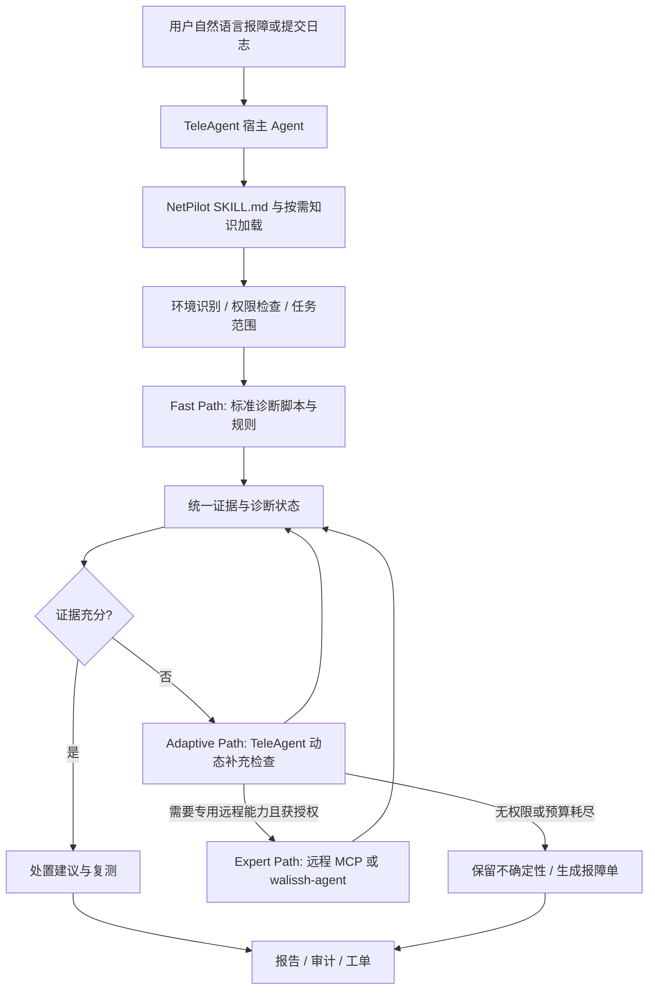

# NetPilot · 网枢 — 网络智能运维 Skill 开发设计文档

> - 版本：v0.1（技术方案草案）
> - 适用对象：项目开发者、Codex 等代码开发助手
> - 参赛平台：TeleAgent（天翼智创杯）
> - 选题方向：网络与运维智能体
> - 文档目标：指导架构讨论、现有代码评估、MVP 开发、集成测试与比赛验收。本文中的功能与指标均为设计目标，不代表已经实现或经过实测。

## 0. 给 Codex 的任务说明

本项目不是从零开发另一个通用 Agent，也不是将现有运维 Agent 简单包装成一个 Skill。目标是为比赛方 TeleAgent 提供一个可独立使用、可验证、可扩展的专业网络运维 Skill，并按需复用现有 walissh-agent。

首次接手时，请先执行以下工作，再提出具体代码修改计划：

1. 阅读本文，并检查当前工作目录、现有仓库、技术栈、启动方式、测试方式以及可以复用的网络诊断、SSH、任务执行、记忆和接口模块。已有模块的实际名称和能力以代码为准，不以本文的假设为准。
2. 检查 TeleAgent 的实际 Skill 导入方式、脚本执行位置、运行环境、网络访问、MCP 或 HTTP 接入能力；列出已验证、未验证和不支持的事项。没有平台文档或可运行环境时，不要自行假设平台接口存在。
3. 给出最小可行架构、拟新增/修改文件、关键接口和分阶段实施方案。优先做一个能真实运行、能在 TeleAgent 内调用的 MVP。
4. 每一阶段都要有可复现的验证方式、测试结果和剩余风险。不要将模拟结果当成真实网络探测结果，不要将未实现的功能写入完成清单。
5. 不要未经讨论重构现有 Agent、引入重型基础设施、增加新的数据库或自行扩大网络操作权限。优先复用现有代码，保持 Skill 可独立部署。

---

## 1. 项目背景和产品定位

### 1.1 场景

校园网络、实验室网络、个人开发服务器等环境中，网络故障通常以自然语言报障开始，例如“连上 Wi-Fi 但无法访问网页”“访问服务器超时”“网络经常断开”。非技术用户难以描述故障证据；管理员需要反复收集网络环境、定位故障层级、判断影响范围并反馈处理结果。

项目优先解决校园网络自助排障与实验室设备辅助运维。上述痛点是待验证的产品假设，开发阶段需要通过访谈、实际报障样本或任务计时验证。

### 1.2 一句话定位

NetPilot 是一个基于真实诊断证据、自适应决策和安全约束的网络运维 Skill，为 TeleAgent 增加网络故障诊断、辅助处置、复测验证与报障交付能力。

### 1.3 目标用户和核心功能

| 用户 | 需求 | 核心输出 |
| --- | --- | --- |
| 普通师生 | 网络异常自助排查，不需要了解专业命令 | 通俗诊断结论、可执行建议、报障单 |
| 实验室管理员 | 排查授权设备、服务及网络配置 | 技术证据、故障假设、修复建议 |
| 网络运维人员 | 分诊、定位影响范围、处理复杂故障 | 诊断报告、拓扑关联、处置记录 |

三个核心功能：

- **网络故障自助诊断**：采集授权环境的真实状态，定位 IP、DNS、网关、代理、TCP、HTTP/TLS 等常见异常。
- **自适应深度诊断与辅助处置**：标准流程不足时动态选择补充检查；确有必要且具备权限时，调用专用远程运维能力。
- **证据化报告与报障交付**：输出故障现象、检测证据、结论置信状态、建议、复测结果及报障信息。

### 1.4 非目标

- 不重新实现 TeleAgent 的基础对话、通用工具路由、通用 Agent Loop。
- 不将完整云服务器部署系统作为参赛 MVP。
- 不默认获取校园网设备管理权限，不进行未授权扫描、批量设备发现或配置变更。
- 不承诺在缺少设备权限、拓扑或观测数据时准确定位所有故障。
- 不强依赖外部 Agent、在线数据库、独立前端或额外模型服务完成基础诊断。

## 2. 比赛约束与设计依据

比赛海报给出的评分权重：问题价值与场景真实性 30%、技术实现与完成度 25%、可用性与体验 20%、创新性 15%、展示与答辩 10%。网络与运维方向的示例包含网络拓扑文档生成、故障排查对话助手、设备配置合规核查、校园网报障分诊。

TeleAgent 官方宣讲材料第 6 页说明基于 Agent Skills 标准的三级渐进加载（元数据、SKILL.md 正文、附属资源），目录包含 `scripts/`、`references/`、`assets/`；第 7 页介绍 L1 配置型、L2 编排型、L3 开发型技能；第 11–13 页介绍第三方技能导入、连接器与 MCP 工具调用。答辩模板要求围绕场景与问题、技能与实现、效果与复用进行展示。

**待确认项：** 官方介绍外部系统和 MCP 接入，不等于确认本次比赛允许自行部署的 Agent、外部模型、远程执行服务或已有项目作为依赖。需要主办方确认参赛限制、既有代码复用及披露要求，并在实际 TeleAgent 环境验证运行能力。

建议技术路线：以 L2 编排型 Skill 为主体，结合 L1 专业知识和 L3 专用工具；外部 Agent 是可选增强，而非基础功能前置依赖。

## 3. 总体架构

### 3.1 核心设计原则

**优先复用工具，必要时才委托 Agent。** TeleAgent 负责自然语言交互和智能决策，Skill 提供专业诊断知识、执行策略和可验证约束，脚本负责真实检测，远程服务负责受控的专用执行。



图中 Skill 是由宿主加载并执行的能力包，不是天然拥有独立进程或独立 ReAct Loop 的运行时。流程状态与强制约束由脚本或受控服务维护；Markdown 指令只负责引导宿主，不能被视为程序级安全边界。

### 3.2 分层职责

| 层 | 职责 | 不负责 |
| --- | --- | --- |
| TeleAgent | 用户交互、意图理解、上下文、工具调用和动态推理 | 替代真实检测结果 |
| Skill 指令与知识层 | 触发、Runbook、证据要求、诊断升级及验收 | 强制权限控制、凭空生成检测数据 |
| 本地诊断脚本 | 环境探测、网络检查、结构化证据、规则匹配 | LLM 推理、任意命令执行 |
| 可选远程工具层 | 授权范围内的专用只读查询和远程诊断 | 无限制远程 Shell |
| 可选专家 Agent | 专用环境、多步远程任务、长期执行控制 | 接管全部普通故障、绕过授权 |
| 报告及状态层 | 证据关联、复测、审计、输出 JSON/Markdown/HTML | 将建议误报为已完成修复 |

## 4. 三路径执行与动态升级

### 4.1 Fast Path（默认）

适用于常见、证据可获取、已有规则可覆盖的任务。优先执行少量高价值检查，再根据结果选择分支，不应每次全量执行所有命令。

例如 IP 配置异常、DNS 解析异常、服务端口不可达、代理配置错误。若证据支持明确结论，直接生成报告；若证据不足或矛盾，则进入 Adaptive Path。

### 4.2 Adaptive Path

由 TeleAgent 依据 Skill 提供的知识和 Runbook 继续推理，维护候选假设，挑选最有区分度的下一项检查，利用现有证据减少重复调用。

触发条件：没有匹配规则、证据相互矛盾、疑似复合故障、已有检查无法区分多个原因、用户提供新信息。

Adaptive Path 不意味着启动另一个 Agent。可以用宿主已有推理能力完成动态诊断。

### 4.3 Expert Path（可选）

仅当需要宿主缺少的专用能力时升级，例如授权远程设备访问、需要跨设备关联、间歇故障持续采集、需要已有 Agent 的任务推进监测和执行环境。

进入条件应同时满足：

1. 任务确实需要专用能力；2. 对应能力已经验证可用；3. 用户/设备授权有效且操作符合安全策略；4. 外部调用符合比赛规定。

若只需要读取远程日志或接口状态，应优先暴露专用 MCP/HTTP 工具，不必启动完整外部 Agent。若外部服务不可用，返回已有证据、未完成事项与人工报障建议，不应导致整个 Skill 失效。

### 4.4 终止、去重与任务状态

建议 MVP 默认预算（可配置，需测试后调整）：单个探测 3–10 秒；单次本地诊断 60 秒；最多 12 次检测调用；相同参数的失败检查默认最多重试 1 次；连续 3 次未产生新增有效证据时停止并输出当前结论。远程长任务采用独立总时长、轮询间隔、取消机制和硬上限，不可通过进度刷新无限延长。

任务状态建议：`CREATED → COLLECTING → ANALYZING → VERIFYING → COMPLETED`。允许 `ANALYZING → COLLECTING` 迭代，另有 `NEEDS_INPUT`、`NEEDS_AUTHORIZATION`、`ESCALATED`、`INCONCLUSIVE`、`FAILED`、`CANCELLED`。`COMPLETED` 表示诊断任务完成，不代表故障已修复；修复状态单独记录。

## 5. 功能范围与优先级

| 优先级 | 功能 | 验收概要 |
| --- | --- | --- |
| P0 | Skill 导入及触发 | 能在真实 TeleAgent 环境加载并触发指定场景 |
| P0 | 环境与探测位置识别 | 能明确检测发生在用户本机、宿主沙箱或远程设备 |
| P0 | 基础网络检测 | IP、网关、DNS、TCP、HTTP/TLS、代理基础检查返回真实结构化结果 |
| P0 | 标准规则诊断 | 至少覆盖 DNS、IP/网关、代理、目标服务异常四类问题及正常网络 |
| P0 | 证据报告与报障单 | 每个关键结论可追溯，明确未知项和复测结果 |
| P0 | 安全、超时和失败处理 | 不执行未授权变更，不伪造结果，不因单次探测失败而崩溃 |
| P1 | 自适应诊断 | 对未知或复合故障补充检查，避免重复探测 |
| P1 | 远程只读诊断工具 | 在授权测试环境验证连接、查询、异常与超时 |
| P1 | 历史案例召回 | 只使用经过确认的脱敏案例，证据优先于历史结论 |
| P1 | HTML 报告与拓扑展示 | 支持导入拓扑，对已知证据标注节点及影响范围 |
| P2 | 外部 Agent 委托 | 证据交接、异步任务状态、可取消、结果验证与降级 |
| P2 | 经授权的辅助修复 | 明确变更、备份/回滚、执行权限、修复复测 |
| P2 | 持续监测 | 仅在平台/后端支持时实现，独立资源预算及安全范围 |

## 6. Skill 文件结构（建议）

```text
netpilot/
├── SKILL.md                         # 唯一技能入口：触发、职责、流程
├── references/
│   ├── runbooks/
│   │   ├── connectivity.md
│   │   ├── dns.md
│   │   ├── ip-gateway.md
│   │   ├── proxy.md
│   │   ├── service-access.md
│   │   └── latency-loss.md
│   ├── network-knowledge.md         # 诊断原理与易误判场景
│   ├── routing-policy.md            # Fast / Adaptive / Expert 切换
│   ├── safety-policy.md             # 权限与数据处理说明
│   ├── evidence-contract.md         # 证据及输出规范
│   └── remote-integration.md        # 可选接入方式，P1/P2
├── scripts/
│   ├── netpilot.py                  # 统一 CLI 入口
│   ├── probes/                      # 分平台、分类型的真实探测器
│   ├── rules.py                     # 确定性证据判断
│   ├── policy.py                    # 参数、授权范围、预算校验
│   ├── state.py                     # 任务状态、证据去重
│   ├── report.py                    # 报告和工单生成
│   └── agent_bridge.py              # 可选外部能力适配器
├── assets/
│   ├── report.html                  # HTML 模板（P1）
│   └── ticket-template.json         # 工单模板
├── tests/                           # 开发/评测资产，不必全部发布到平台
│   ├── fixtures/
│   ├── test_rules.py
│   ├── test_policy.py
│   └── test_integration.py
└── README.md                       # 安装、运行、限制、演示
```

实际目录以 TeleAgent 导入格式、脚本依赖和打包要求为准。`tests/` 等开发资源可留在仓库而不进入发布包。优先 Python 标准库与系统已有命令；若 Windows 本地执行需要 PowerShell，按运行环境适配，不假设必须安装 Python 或拥有管理员权限。

### 6.1 SKILL.md 初稿（供 Codex 修改）

```markdown
---
name: netpilot
description: Diagnose authorized campus, laboratory and server network problems with real evidence. Use when users report network connectivity, DNS, gateway, proxy, latency, or service access issues, or request a network incident report. Do not use for unauthorized scanning or unrelated deployment tasks.
---
# NetPilot

1. 明确故障现象、受影响范围、目标和可用检测环境。
2. 确认检测位置与权限；没有用户设备访问能力时，要求用户提供诊断输出或在授权环境运行采集工具，不以沙箱结果代替用户本机结果。
3. 按故障类型读取 references/runbooks/ 中对应文件，执行最小必要的只读检查。
4. 使用 scripts/netpilot.py 的结构化结果；保留证据 ID、检测位置、状态、时间和关键实际值。
5. 标准规则足以支持结论时输出报告；否则进入动态诊断，选择可区分候选原因的下一项检查。
6. 只有确需专用远程能力并通过授权、平台与比赛约束检查时，才允许调用已配置的外部工具或 Agent。
7. 不绕过权限，不猜测未采集的网络信息，不声称未验证的故障已经修复。
8. 输出通俗结论、关键证据、影响范围（未知则标明）、下一步建议、验证状态及必要的报障单。
```

上面是指令入口示例，不包含尚未验证的平台特有字段。命令语法应在 CLI 实现后补全，避免 Skill 指令引用不存在的脚本选项。

## 7. 诊断执行层设计

### 7.1 P0 探测器

| 探测类型 | 建议采集 | 关键约束 |
| --- | --- | --- |
| 环境识别 | OS、网络接口、检测位置、工具可用性 | 不将云端沙箱当作用户本机 |
| 接口/IP | 活跃接口、地址、默认路由、DHCP 状态（可获取时） | 多网卡、VPN、IPv6 情况需单独判断 |
| 网关/连通性 | 默认网关与已批准目标的可达性 | ICMP 无响应不等于断网 |
| DNS | 当前配置、系统解析结果、耗时与错误类别 | 不擅自修改 DNS 或使用不符合网络政策的解析器 |
| TCP | 用户指定且授权的单个主机/端口连接结果 | 禁止端口范围扫描；超时不等于防火墙故障 |
| HTTP/TLS | 状态码、重定向、证书验证结果、分阶段耗时（可获取时） | 不绕过证书验证，不请求含凭证的 URL |
| 代理 | 系统/环境代理是否配置及基本状态 | 遮盖代理账号、密码、Token 和敏感地址 |
| 性能（P1） | 有限次数的延迟、抖动、丢包采样 | 仅授权目标，限制速率，不进行压力测试 |

Windows、Linux 的命令适配应通过实际环境验证。例如 Windows 可考虑 PowerShell 网络 cmdlet，Linux 可考虑 `ip`、`getent` 等；不存在的命令应返回 `unsupported`，不能直接判成网络故障。CLI 参数应结构化，调用子进程时使用参数数组、白名单和超时，避免 `shell=True` 与任意用户输入拼接。

### 7.2 规则和 Runbook 示例

| 现象或证据组合 | 下一步 / 结论约束 |
| --- | --- |
| 活跃接口不存在或未连接 | 检查网络接口状态，确认用户目标网络；不能直接认定网卡硬件损坏 |
| IPv4 地址为链路本地地址且预期 DHCP | 提示疑似 DHCP 分配问题，核查是否存在有效 IPv6 或其他接口 |
| IP 层或指定 TCP 连接成功、系统 DNS 失败 | 优先排查 DNS；检查当前解析配置和错误类型，必要时在政策允许下比较解析结果 |
| DNS 成功但 TCP 超时 | 排查目标服务、路由及访问策略，不能直接认定防火墙故障 |
| TCP 成功但 TLS 校验失败 | 检查证书、主机名、系统时间、代理链路；不得关闭证书验证作为修复 |
| HTTP 认证重定向或疑似门户 | 提示检查校园网登录/认证状态；不自动提交账号密码 |
| 所有已执行检查正常 | 只说明测试时、测试目标及观测范围内未发现异常，不保证网络永久正常 |
| 无足够证据或多个假设矛盾 | 输出 `inconclusive`，说明缺少的观测信息，进行补充检查或报障 |

规则中应明确正向证据、反向证据、必要前提及下一步。不要用 LLM 自报的百分比置信度代替证据充分性。规则可先用 Python 直接实现，需求稳定后再考虑 YAML/JSON 配置化。

### 7.3 统一 CLI（拟定契约）

```text
python scripts/netpilot.py capabilities
python scripts/netpilot.py diagnose --scenario connectivity --target <authorized-host> --output json
python scripts/netpilot.py probe --type dns --target <authorized-host> --output json
python scripts/netpilot.py report --input <evidence-file> --format markdown
```

以上命令为拟定接口，并非当前可运行命令。应根据宿主脚本执行方式修改。机器可读输出走 stdout，日志走 stderr；诊断发现故障属于正常业务结果，而非程序崩溃。建议 exit code：0 表示命令已完成（包括检测到故障），2 参数或权限错误，3 运行异常；具体业务状态由 JSON 表达。

## 8. 数据契约

### 8.1 Evidence（单条检测证据）

```json
{
  "schema_version": "1.0",
  "evidence_id": "ev-003",
  "task_id": "diag-001",
  "probe": "dns_resolution",
  "target": "example.test",
  "origin": {"type": "user_device", "device_id": "lab-client-01"},
  "source": "system_resolver",
  "observed_at": "2026-11-24T08:00:00Z",
  "status": "timeout",
  "expected": "successful_resolution",
  "actual": {"error_type": "resolver_timeout"},
  "duration_ms": 3000,
  "simulated": true
}
```

本例为模拟数据。`status` 枚举建议：`pass`、`fail`、`timeout`、`unsupported`、`denied`、`error`、`skipped`。每个证据必须带检测位置与时间；对导入日志应标注其来源、采集时间（未知可为空），不可伪装为实时检测。

### 8.2 DiagnosisResult（诊断结果）

```json
{
  "schema_version": "1.0",
  "task_id": "diag-001",
  "path": "fast",
  "status": "suspected",
  "summary": "疑似 DNS 解析异常",
  "hypotheses": [
    {
      "id": "dns_failure",
      "state": "suspected",
      "supporting_evidence_ids": ["ev-003"],
      "contradicting_evidence_ids": [],
      "missing_evidence": ["IP connectivity check", "resolver configuration"]
    }
  ],
  "impact_scope": "unknown",
  "next_actions": ["验证目标 IP 或 TCP 连通性", "核查系统 DNS 配置"],
  "remediation_status": "not_attempted",
  "verification_status": "not_run",
  "escalation_reason": null,
  "limitations": ["单次 DNS 超时不足以确认根因"]
}
```

结论状态建议：`confirmed`（证据满足规则且排除必要替代解释）、`suspected`（证据支持但不充分）、`inconclusive`（不足以定位）、`no_issue_detected`（观测范围内未发现异常）。修复与复测状态单独记录，避免把诊断完成等同于故障解决。

### 8.3 诊断状态与证据传递

状态至少包含 task_id、授权范围、检测环境、已执行探测及参数摘要、证据引用、候选假设、剩余预算、已拒绝/跳过事项。MVP 可使用当前任务的本地 JSON 文件或内存状态，暂不引入数据库。跨回合状态如果宿主不支持持久化，应明确限制。

## 9. 与 walissh-agent 集成设计（可选）

### 9.1 复用顺序

当前已知项目具备父 Agent、排查 Agent、执行 Agent、记忆、上下文富化等设计，以及执行推进检测的相关开发计划。具体实现、成熟度及接口需由 Codex 检查仓库确认，不应假设全部已经可直接复用。

1. 优先抽取已有 SSH、网络状态、日志查询等能力为结构化只读工具（适配实际设备类型）。
2. 若 TeleAgent 支持自定义 MCP，优先评估 MCP 工具接入；否则在脚本网络访问获准时使用受控 HTTP API。两者均不可用时保持离线/本地模式。
3. 仅当工具级复用无法满足专用执行环境或长任务控制需求时，才暴露完整 Agent 委托能力。
4. 现有项目保持独立；Skill 只依赖稳定接口，不直接依赖内部 Agent 类、数据库或 UI。

### 9.2 拟定远程工具契约

| 工具 | 输入概要 | 输出概要 |
| --- | --- | --- |
| `get_device_status` | 授权 device_id | 设备及接口状态、证据 |
| `check_remote_connectivity` | device_id、目标、探测类型 | 指定设备视角的探测结果 |
| `get_service_status` | device_id、预定义 service_id | 服务状态、相关证据 |
| `get_recent_logs` | device_id、日志类别、时间范围、数量上限 | 脱敏日志及来源 |

不要直接暴露任意 `execute_shell(command)` 作为默认工具。若后端已有通用执行工具，也要通过限制操作类型、设备授权和参数校验的适配层访问。用户名、SSH 私钥和 Token 由受控后端管理，不放入 Skill 包、提示词或报告中。

### 9.3 Agent 委托接口（拟定 HTTP 示例）

- `POST /api/v1/diagnosis/tasks`：提交任务；服务端返回 task_id 与初始状态。
- `GET /api/v1/diagnosis/tasks/{taskId}`：查询进度、证据、结果及状态。
- `POST /api/v1/diagnosis/tasks/{taskId}/cancel`：请求取消（后端需真实支持）。

上述路径是设计提案，不是已有 API。异步任务的轮询必须受到宿主执行能力、超时和次数限制；如果宿主不能持续轮询，应返回任务编号及当前状态，等待后续主动查询。

```json
{
  "request_id": "req-001",
  "task_type": "remote_network_diagnosis",
  "objective": "分析授权实验服务器服务不可达的原因",
  "device_id": "lab-server-01",
  "existing_evidence": [],
  "remaining_hypotheses": ["service_not_listening", "path_or_policy_issue"],
  "allowed_operations": ["read_status", "read_logs", "probe_authorized_target"],
  "budget": {"max_duration_seconds": 120, "max_tool_calls": 15},
  "allow_changes": false
}
```

服务端必须独立验证身份、设备范围、权限、预算；请求体中的授权字段只是任务意图，不是授权凭证。建议使用 HTTPS、短期或受管凭证、request_id 幂等控制、结果 schema 校验，避免重复发起任务。外部 Agent 返回的结论也应通过证据及复测规范进行验收，不能无条件信任。

## 10. 安全与数据治理

- 默认只读。用户身份和设备权限必须由可信运行时或服务端确定，不能凭用户自然语言自称管理员授予权限。
- 明确目标范围，仅对本人设备、指定服务或得到许可的测试设备进行检测。禁止未授权扫描、访问其他宿舍设备、抓取他人流量或绕过校园网控制。
- P0/P1 不自动修改真实校园网或生产设备配置。P2 如获批准，可引入明确的变更预览、单次授权、备份/回滚和验证机制；重启核心设备、修改关键路由/防火墙等默认禁止。
- 程序级执行限制：固定探测类型、参数校验、时间/调用/并发上限、必要的目标限制与审计；不能仅依赖 Markdown 中的提示词。
- 远程连接仅访问配置好的授权设备或目标；防止将用户任意 URL 当作后端请求目标，校验解析地址和重定向目标，避免越权或访问内部敏感资源。
- 采集最小必要数据；日志、配置、报障单和历史案例需脱敏，不保留账号密码、认证 Token、SSH 密钥等。外部传输需符合用户授权、平台及校园数据政策。
- 将设备日志、网页响应、配置文件等视为不可信数据；其中出现的命令或提示不得直接成为执行指令。HTML 报告对输入内容进行转义，防止注入。
- 诊断操作应区分建议、已执行、失败、无法验证四类状态，不能宣称未执行的修复已经成功。

## 11. 报告、交互和可视化

用户不需要输入专业命令即可开始诊断。仅询问影响范围、设备/系统、目标服务等必要信息；若已经能做只读检查则先做检查。

报告建议同时提供面向普通用户的简版和面向运维人员的证据详情：

| 字段 | 内容 |
| --- | --- |
| 结论 | 一句话说明故障类别与确定程度 |
| 检测位置 | 本机/宿主沙箱/授权远程设备/用户提供日志 |
| 证据 | 检测项目、结果、时间、证据 ID |
| 影响范围 | 已知受影响的设备、服务或位置；未知则注明 |
| 下一步 | 用户可安全完成的操作，或交给管理员的建议 |
| 复测 | 是否执行、结果以及与初始故障的对比 |
| 工单 | 故障现象、时间、已完成检查、待处理事项 |

HTML 可视化为 P1，优先复用宿主输出/文件生成能力。拓扑图必须来自导入的拓扑、配置或经过授权的采集，不得仅凭一个终端的路由结果推断完整校园网。拓扑节点可标注正常、异常、疑似、未知、受影响（推断）及证据引用。

历史案例为 P1：仅保存脱敏且经确认的故障现象、环境特征、证据、根因和复测结果；召回只是辅助假设，当前观测优先。先使用少量本地 JSON 案例或平台已有知识能力，不必直接引入向量数据库。

## 12. 运行环境与平台接入预研（开发前置）

在编写复杂功能前，创建一个最小测试 Skill，验证：

| 项目 | 验证内容 | 失败时的降级 |
| --- | --- | --- |
| Skill 导入 | 文件结构、打包、触发描述、相对路径读取 | 按实际平台格式调整 |
| 脚本执行 | 能否运行 Python/PowerShell、依赖、stdout、超时 | 使用支持的脚本或导入用户采集结果 |
| 运行位置 | 本机、远程云端或隔离沙箱 | 必须将检测位置写入结果；无法访问本机则让用户提供数据 |
| 网络访问 | 可否访问授权测试目标、外部 HTTPS、代理限制 | 离线规则及报告模式 |
| MCP 接入 | 能否添加自定义服务及授权 | 评估脚本 HTTP；不支持则跳过远程扩展 |
| 文件交付 | Markdown/HTML/JSON 报告生成及下载 | 文本报告直接输出 |
| 多轮状态 | 会话或脚本运行之间能否保留证据 | 使用平台允许的任务文件或用户提供报告 |
| 外部 Agent | 比赛许可、接口访问、身份及长任务限制 | 不启用 Expert Agent，保留 Fast/Adaptive |

预研输出：一份 `platform-compatibility.md`，记录每项验证过程、实测结果与环境版本。尤其不能将宿主沙箱的网络检测当成学生电脑网络检测，这是整个项目最大的正确性风险之一。

## 13. 开发路线与阶段验收

### Phase 0：平台验证和现有项目评估

完成第 12 节最小 Skill 验证；梳理 walissh-agent 的可复用模块、接口、安全边界。交付架构选择记录及 MVP 清单。

### Phase 1：独立 Skill MVP（优先）

实现环境识别、核心探测、统一证据、4 类常见故障 Runbook、规则诊断、Markdown/JSON 报告、超时和只读策略。先在本地 CLI 跑通，再接入 TeleAgent。至少演示一个正常网络案例、一个真实可控故障案例和一个无法充分定位案例。

验收：不依赖 walissh-agent；能在 TeleAgent 实际触发并完成报告；证据可追溯，模拟结果有清晰标记，未授权操作被拒绝。

### Phase 2：自适应诊断和工程化

加入候选假设、动态补充检查、证据去重、预算与状态管理；按平台能力增加授权远程只读工具、HTML 报告、案例召回与拓扑标注。建立对照测试。

验收：同一故障不无意义重复检查；证据不足时正确升级或退出；复合故障能展示多步诊断；报告内容和证据一致。

### Phase 3：专家能力增强（有条件实施）

在获得比赛许可并验证接口后，接入 walissh-agent；实现结构化证据交接、状态查询、取消、失败降级、结果验收。若没有许可或平台不支持，则以 TeleAgent 自身的动态诊断为最终方案。

验收：外部 Agent 宕机不影响独立 Skill；任务预算和授权由服务端控制；完整流程能证明专家模式在至少一个专用场景中的实际增益。

## 14. 测试与评测方案

### 14.1 测试分层

- 单元测试：规则匹配、证据格式、参数校验、预算、去重、脱敏和报告生成。
- 集成测试：真实探测器、Skill CLI、TeleAgent 导入/调用、授权远程接口、外部 Agent 超时和失败降级（如启用）。
- 故障注入：只在个人设备、隔离 VM、容器或批准的实验网络中进行；避免影响真实校园网和他人设备。
- 用户测试：让非技术用户完成报障或排查，记录任务时长、追问次数、是否理解报告和建议；取得同意并脱敏。

### 14.2 建议评测集（30 个场景目标）

| 类别 | 数量 | 例子 |
| --- | ---: | --- |
| DNS | 4 | 解析超时、域名不存在、解析配置异常、单域名故障 |
| DHCP/IP | 4 | 接口未连接、地址异常、多网卡误选、DHCP 失败 |
| 网关/路由 | 4 | 缺少默认路由、不可达、路由选择异常、VPN 影响 |
| 代理 | 3 | 错误代理、代理不可达、应用代理差异 |
| TCP/服务/TLS | 4 | 服务未监听、连接超时、证书异常、HTTP 错误 |
| 性能 | 3 | 延迟、抖动、间歇丢包 |
| 复合故障 | 4 | 多个同时存在的异常、观测冲突、证据不足 |
| 正常网络 | 4 | 普通正常、ICMP 禁用但业务正常、多接口、IPv6 可用 |
| 合计 | 30 | 开发目标，非已测数量 |

每个用例包含真实根因或预设注入点、授权环境、输入、预期证据、可接受结论、禁止行为、恢复方式。模拟 fixture 与真实运行结果分开统计。

### 14.3 对照组与指标

| 组别 | 目的 |
| --- | --- |
| 人工排查（条件允许时） | 验证实际提效和交互价值 |
| 原生 TeleAgent | 宿主基线 |
| TeleAgent + NetPilot | 证明 Skill 独立增益 |
| TeleAgent + NetPilot + 专家 Agent | 验证额外接入是否有价值，仅在启用后评测 |

尽量统一模型、工具权限、测试环境和任务预算；如新增工具只能由 Skill 访问，要区分工具可用性增益和编排/知识增益（可另设相同工具但无 Skill 的消融组）。

核心指标：根因定位准确率（正确定位数/总可定位故障数）、任务完成率、正常网络误报率、平均或中位诊断时间、工具调用次数、重复调用次数、安全违规次数、用户完成报障耗时。对不确定案例单独报告合理拒绝定位率；不能把输出报告就算作根因定位成功。Token 消耗仅在平台能够真实获取时统计。

建议工程验收线（待预研后调整）：P0 固定测试集全部通过；未授权变更执行次数为 0；所有关键诊断结论具备证据引用；外部服务不可用时独立 Skill 可用。比赛效果页只展示实际测得的数据，不预填准确率或提效比例。

## 15. 比赛演示与交付物

建议演示主线：普通学生发现网络异常 → TeleAgent 触发 NetPilot → 真实采集 → 证据定位 → 可理解的处理建议 → 在隔离环境恢复故障后复测 → 生成报障/诊断报告。再展示一个标准规则不足的复合故障，体现 Adaptive Path；若专家模式已验证，追加远程授权设备案例。

演示环境准备真实运行的可控实验网络、正常及故障状态切换脚本（仅用于隔离环境）、备用报告和录屏。若现场只能使用模拟数据，必须明确标注，不假装成实际校园网。

比赛答辩对应官方模板：场景与问题（访谈、报障痛点）；技能与实现（三个核心功能、架构与创新）；效果与复用（真实对照数据、跨校园/实验室/企业场景复用）。

交付物建议：

- 可导入的 Skill 包及 README；开发源码、测试和可复现的隔离实验环境说明。
- 平台兼容性记录、安全约束与权限说明、接口契约。
- 实测结果表、典型诊断报告、演示录屏或备用材料。
- 三页核心答辩内容及现有项目复用说明（按比赛要求披露）。

## 16. 架构讨论时必须作出的决策

| 决策 | 默认建议 | 需要 Codex 确认 |
| --- | --- | --- |
| 本机数据如何获取 | 宿主本机脚本优先，无法执行则导入诊断输出 | TeleAgent 实际脚本位置与权限 |
| 诊断逻辑如何拆分 | 确定性规则在程序中，动态假设由 TeleAgent 处理 | 宿主工具调用与状态能力 |
| 是否独立写 Agent Loop | 否 | 宿主能力不足的具体证据 |
| 是否调用 walissh-agent | 非 MVP 依赖；优先复用专用工具 | 比赛许可、仓库实际能力、API 可达性 |
| 数据存储 | MVP 本地任务 JSON 或内存 | 运行时文件权限、持久化支持 |
| 设备与权限管理 | 使用受控设备清单，默认只读 | 现有后端认证、授权和审计机制 |
| 开发语言 | Skill 轻量脚本优先，现有 Java 后端不重写 | 平台运行环境、已有项目技术栈 |
| 是否自动修复 | MVP 仅建议与复测；P2 有条件开放 | 授权、回滚、平台与比赛限制 |

**最终设计原则：Skill 必须有独立专业价值，TeleAgent 必须真正参与执行，外部 Agent 必须带来可验证的能力增益。以可工作的 MVP 为起点，逐步证明真实场景价值，而不是先堆叠架构。**

---

## 附录：资料来源与已知限制

1. 用户提供的比赛海报：选题方向、评分权重及奖项设置。
2. 《铁道大学宣讲.pptx》：第 2 页自主式智能体能力；第 6–7 页 Skill 结构、渐进加载及分级；第 11–13 页导入技能、连接器、MCP 架构；第 18 页校园服务场景示例。
3. 用户提供的比赛答辩模板 `b989a084e2d14f449923d235fbd4c23a.pptx`：第 2–4 页核心答辩内容与实测要求。
4. 已讨论的 walissh-agent 项目现状；需以实际源码及测试核实。本设计未审阅当前仓库源码，也未实际运行 TeleAgent 或确认比赛外部 Agent 接入规则。

除明确标注的官方材料内容外，本文的架构、文件名、接口、预算、测试场景和验收建议均为拟定设计，不是平台既有 API 或已经完成的项目功能。
